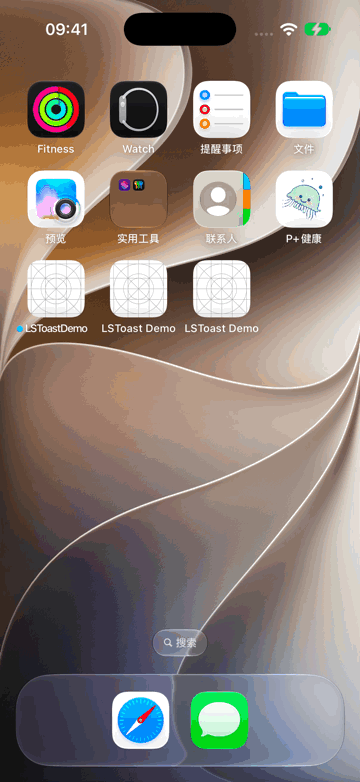

# LSToast

[English](README_EN.md) · [安装说明](docs/installation.md) · [设计与隔离边界](docs/architecture.md) · [1.0.0 验证记录](docs/validation.md)

基于 [LSTPopView](https://github.com/LoSenTrad/LSTPopView) 的 UIKit 轻提示组件。吐司的显示、替换和隐藏只操作自己的弹窗实例，保留 App 内业务弹窗、等待队列和输入焦点。

```swift
import LSToast

LSToast.show("保存成功", in: view)
```



演示工程：[Examples/LSToastDemo](Examples/LSToastDemo)。演示包含业务弹窗与吐司共存、等待弹窗、输入焦点、连续替换和位置切换。

| 集成示例 | 用途 |
| --- | --- |
| [SPM Demo](Examples/LSToastDemo) | 直接打开工程运行，只关联 LSToast 产品 |
| [CocoaPods Demo](Examples/CocoaPods) | `pod install` 自动解析完整依赖后运行 |
| [Carthage Demo](Examples/Carthage) | 链接并嵌入两个动态 XCFramework |
| [精简调用代码](Examples/QuickStart.swift) | 复制到自己的控制器中使用 |

## 特性

- 默认显示 2 秒，支持顶部、居中、底部和多行文本。
- 每个业务窗口单独管理吐司；同一窗口连续显示时保留最新一条。
- 透明宿主视图完整穿透触摸，包括文字区域，底层按钮和手势仍可交互。
- 不创建新窗口，不抢 key window，不调用 `endEditing`。
- 仅关闭本次吐司，不调用弹窗管理器的全局移除方法。
- 单次显示的弱引用 `Handle`，旧句柄和旧计时器不会关闭后来的吐司。
- 支持 Dynamic Type 和安全区域布局。
- CocoaPods、Swift Package Manager、Carthage 均将 LSTPopView 作为**独立依赖自动获取**。

## 系统与工具链

| 安装方式 | 最低系统 | 编译器 / 工具链 | 自动安装的弹窗依赖 |
| --- | --- | --- | --- |
| CocoaPods | iOS 15 | Swift 5.9 及以上 | `LSTPopView ~> 0.3.10`（Objective-C），以及它的 `LSTTimer` 依赖 |
| Swift Package Manager | iOS 15 | Swift 6.2 / Xcode 26 及以上 | LSTPopView 仓库中的 `LSTPopViewSwift` 原生 Swift 产品，固定版本 [`1.0.0-lstoast.1`](https://github.com/LoSenTrad/LSTPopView/releases/tag/1.0.0-lstoast.1)（提交 `a6099ec`） |
| Carthage | iOS 15 | Swift 6.2 / Xcode 26 及以上；Carthage 0.38+ | 独立的 `LSTPopViewSwift` 动态框架，同一固定 revision |

三种方式的吐司 API 一致。弹窗依赖的模块名和 API 随安装方式不同，见[直接使用弹窗库](docs/installation.md#直接使用-lstpopview)。不要把同一个 LSToast 同时用多种包管理器加入同一个 target。

## 安装

### CocoaPods

在 `Podfile` 中只需声明 LSToast：

```ruby
platform :ios, '15.0'

target 'YourApp' do
  use_frameworks!
  pod 'LSToast', '~> 1.0'
end

post_install do |installer|
  minimum = Gem::Version.new('15.0')

  installer.pods_project.targets.each do |target|
    target.build_configurations.each do |config|
      current = config.build_settings['IPHONEOS_DEPLOYMENT_TARGET']
      next unless current.to_s.match?(/\A\d+(?:\.\d+)*\z/)
      next unless Gem::Version.new(current) < minimum

      config.build_settings['IPHONEOS_DEPLOYMENT_TARGET'] = '15.0'
    end
  end
end
```

旧版弹窗依赖的 Pod target 声明了较低的系统版本；Xcode 27 等新工具链需要上面的 `post_install` 将低于 iOS 15 的 target 提到 15。它只调整消费者工程的构建设置，不改上游源码或版本。已有 `post_install` 时把这段循环合并进现有回调。

执行 `pod install`，然后打开生成的 `.xcworkspace`。Podspec 会自动解析 `LSTPopView` 和 `LSTTimer`，不需要把它们另写一遍。

**1.0.0 已发布到 CocoaPods 公共 Specs，可以直接使用上面的版本声明安装。** 发布记录可通过 `pod trunk info LSToast` 查询；公共 podspec 见 [CocoaPods Specs](https://github.com/CocoaPods/Specs/blob/master/Specs/1/f/d/LSToast/1.0.0/LSToast.podspec.json)。

如果需要直接使用 Git tag，也可将 Pod 声明替换为：

```ruby
pod 'LSToast', :git => 'https://github.com/LoSenTrad/LSToast.git', :tag => '1.0.0'
```

验证记录与发布边界见 [1.0.0 验证记录](docs/validation.md)。

### Swift Package Manager

在 Xcode 选择 **File → Add Package Dependencies…**，输入：

```text
https://github.com/LoSenTrad/LSToast.git
```

选择从 `1.0.0` 开始的版本，只将 `LSToast` 产品加入 App target。Xcode 会自动获取上游 LSTPopView 包和 `LSTPopViewSwift` 产品。LSToast 的 SPM 产品使用静态链接，包含传递依赖符号；App 可直接 `import LSTPopViewSwift`，无需再向同一 App target 重复添加或嵌入上游产品。

也可在自己的 `Package.swift` 中声明：

```swift
.package(url: "https://github.com/LoSenTrad/LSToast.git", from: "1.0.0")
```

然后在 target 的 `dependencies` 中添加：

```swift
.product(name: "LSToast", package: "LSToast")
```

### Carthage

在 `Cartfile` 中添加：

```text
github "LoSenTrad/LSToast" ~> 1.0
```

执行：

```sh
carthage update --use-xcframeworks --platform iOS
```

Carthage 会沿仓库内的 `Cartfile` 自动获取并构建上游弹窗依赖。把 `Carthage/Build` 下的 **`LSToast.xcframework` 和 `LSTPopViewSwift.xcframework` 两个文件**都加入 App target 的 **Frameworks, Libraries, and Embedded Content**，均设置为 **Embed & Sign**。Carthage 不会替你修改 App 工程；只嵌入 LSToast 会缺少运行时依赖。参见 [Carthage 的 XCFramework 集成指南](https://github.com/Carthage/Carthage#building-platform-independent-xcframeworks-xcode-12-and-above)。

## 使用

以下 API 均在 `MainActor` 调用。UIKit 控制器的交互回调可以直接使用：

```swift
import UIKit
import LSToast

final class ProfileViewController: UIViewController {
    func didSave() {
        LSToast.show("保存成功", in: view)
    }

    func showNetworkMessage() {
        LSToast.show("网络暂时不可用，请稍后重试", in: view,
                    duration: 3, position: .bottom)
    }

    func dismissMessage() {
        LSToast.hide(in: view, animated: true)
    }
}
```

从后台任务切回主 actor：

```swift
await MainActor.run {
    LSToast.show("同步完成", in: view)
}
```

### 关闭某一次显示

```swift
let first = LSToast.show("第一条", in: view, duration: 5)
let second = LSToast.show("第二条", in: view, duration: 5)

first?.hide()          // 只关联第一条，不能关闭第二条
print(second?.isVisible == true)
second?.hide(animated: false)
```

`LSToast.hide(in:)` 隐藏指定窗口当前的吐司。`handle.hide()` 只隐藏该句柄对应的实例。句柄不强持有 presenter，以本次显示标识区分请求，不必保存句柄才能自动消失。

### 位置与窗口

```swift
LSToast.show("顶部提示", in: view, position: .top)
LSToast.show("居中提示", in: view, position: .center)
LSToast.show("底部提示", in: view, position: .bottom)
```

建议传入当前页面已经进入窗口的 `view`，也可传入该页面的 `UIWindow`。多 scene App 尤其应显式指定所属窗口。省略 `in:` 时尝试寻找活动 key window，不负责在多个业务窗口间猜测目标。

纯空白文本、没有可用可见窗口时，`show` 返回 `nil`。非正数、NaN 或无限的 `duration` 回退到默认 2 秒。吐司用于短暂提示；不要使用超长时长充当加载遮罩。

## 业务弹窗隔离

LSToast 为每个业务窗口建立自己的透明父视图，并把吐司的 `LSTPopView` 放入这个父视图。它的显示、替换、计时关闭和手动隐藏都只操作自己保存的实例；不会调用 `removeAllPopView`、`removeLastPopView` 或接管业务弹窗的队列。

底层依赖仍是独立安装、可被 App 直接使用的弹窗库。吐司仍属于该依赖的全局管理范围，App 主动调用 `removeAllPopView` 或 `removeLastPopView` 时可能同时移除吐司；LSToast 不拦截 App 的管理器调用。具体边界见[设计说明](docs/architecture.md)。

吐司没有交互控件，也不会自动切换辅助功能焦点。需要用户确认、长时间阅读或必须被听读的消息，请提供页面内状态或合适的无障碍交互。

## 运行 Demo 和测试

```sh
git clone https://github.com/LoSenTrad/LSToast.git
cd LSToast
open Examples/LSToastDemo/LSToastDemo.xcodeproj
```

选择 **LSToastDemo** scheme 和一个 iPhone 模拟器运行。Demo 引用仓库根目录的本地 LSToast Package，上游弹窗包由 SPM 自动解析，不需要运行 `pod install`。

托管测试 target 的最低系统是 **iOS 16**，使用 Swift Testing / ContinuousClock；库与 Demo App 的最低系统仍是 iOS 15。在支持的 macOS / Xcode 环境运行：

```sh
./scripts/test-demo.sh
```

也可先通过 `xcrun simctl list devices available` 确认可用的 iOS 16+ 模拟器，再指定：

```sh
SIMULATOR_UDID=你的模拟器UDID OUTPUT_DIR=/tmp/LSToast-check ./scripts/test-demo.sh
```

测试聚焦弹窗队列隔离、触摸穿透、输入焦点、窗口归属、连续替换、旧句柄和到期释放。CI 配置代表检查流程；某个提交的实际结果以该提交的 Actions 和 `.xcresult` 为准。

## 贡献与许可

提交问题时请附上安装方式、Xcode / Swift / iOS 版本，以及可以复现的最小代码。开发说明见 [CONTRIBUTING.md](CONTRIBUTING.md)，版本记录见 [CHANGELOG.md](CHANGELOG.md)。

LSToast 使用 [MIT License](LICENSE)。LSTPopView 及其依赖保留各自的许可证和版权；见 [NOTICE](NOTICE)。
